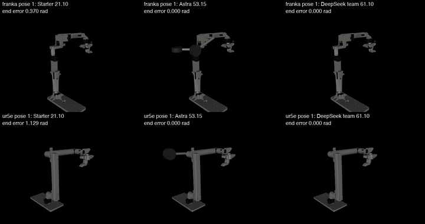
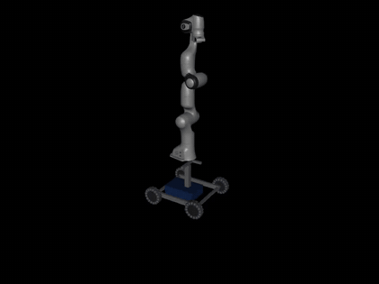
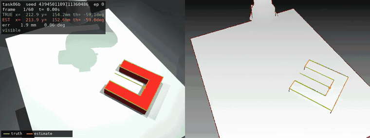

# deepbotics

Team Berkseek: Alexander, Stella and Jenny. Built for Fireworks: Deploy.

## The problem

AI has advanced, but that hasn't translated into real-world impact. Manual work like packing boxes and machine loading either lacks the right robots or is too expensive to automate at scale. We aim for smarter robot arms at a fraction of the cost.

## Tech stack

- DeepSeek V4.1 Flash through Fireworks; GPT-6 Astra through native Codex as the baseline
- Python scripts to coordinate DeepSeek workers
- MuJoCo to simulate robots
- RLE-Bench for tasks that run locally on a MacBook
- FFmpeg to render videos

We cut development time to 15 minutes. The official scorers are unchanged.

## Results

Baseline: one Astra agent. Ours: 14 DeepSeek agents with a custom harness.

| Task | Astra | DeepSeek swarm | Astra cost | DeepSeek cost |
| --- | ---: | ---: | ---: | ---: |
| 09: balanced handheld robot arm | 53.15 | **61.10** | $2.81 | $1.55 |
| 08: mobile base and controller | **63.71** | 58.19 | $4.51+ | $1.19 |
| 06: RGB-D pose estimation | **89.53** | 32.08 | $3.53+ | $0.96 |

Techniques: fast shared tests, agents copying and improving the best measured designs, and a public score choosing the final design.

Evidence is in [`benchmarks/`](benchmarks/).

## Demos

**Task 09: starter, Astra and DeepSeek swarm.** The starter collapses; both finished designs hold pose. ([video](assets/demos/task09-hold.mp4))

**Task 08: final DeepSeek mobile base.** ([video](assets/demos/task08-base.mp4))

**Task 06: final DeepSeek pose estimator on a scored episode.** ([video](assets/demos/task06-pose.mp4))

## Limitations

- One run of each configuration.
- This compares configured systems, not models. DeepSeek had a tuned harness and written guidance; Astra had the task text.
- Tasks 08 and 06 are retries from prepared starts; first runs scored 38.39 and 13.30. Astra started cold.
- Astra costs are API-equivalent estimates.

Full details and setup: [`docs/evaluation-notes.md`](docs/evaluation-notes.md).
